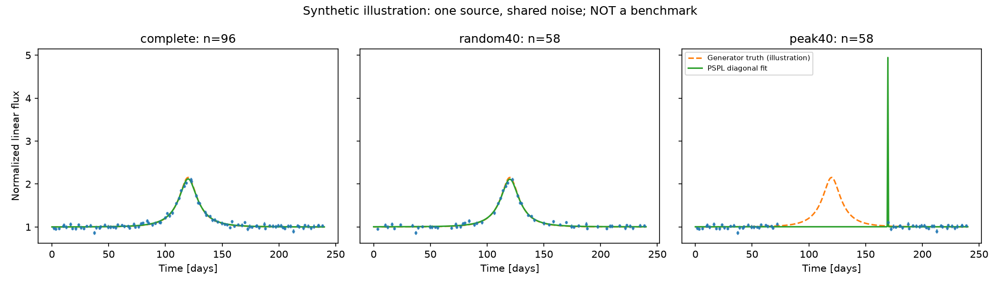
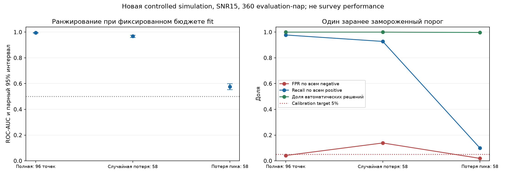

# AstroML — надёжность обнаружения гравитационного микролинзирования

Исследовательский проект для олимпиады **«Шаг в будущее», профиль «Инженерное дело», 2026/27**. Выбранная секция: **«Системы обработки информации» (ИУ5)**. Регистрация в секции ещё не подтверждена.

**Вопрос проекта:** как отличать микролинзирование от похожих изменений блеска, если наблюдения шумные, нерегулярные или пропущен максимум события — и когда алгоритму нельзя доверять?

Цель — подготовить воспроизводимую исследовательскую работу, которую автор понимает и лично защищает: физическая модель → эксперимент → проверка → выводы и ограничения → демонстрация.

> **Текущее состояние, 01.11.2026.** Исторические этапы 2–4 сохранились в отчётах, но их код и сырые результаты не переданы. Этот репозиторий начинает явно обозначенную реконструкцию. Этап 5 не завершён и не подтверждён. Новая минимальная реализация не является восстановленным историческим Git-снимком.

Репозиторий: [Mobzya/astroML](https://github.com/Mobzya/astroML).

## Навигация

- [План исследования и разработки](research/research_plan.md)
- [Аудит восстановления и реестр утверждений](reports/recovery_audit.md)
- [Текущий статус и следующий шаг](research/STATUS.md)
- [Секция, сроки и руководитель](defense/section_and_rules.md)
- [Проект протокола нового опыта](research/experiment_05_protocol.md)
- [Литературная матрица](research/literature_matrix.csv)
- [Самостоятельный вклад и помощь ИИ](research/contributions.md)
- [Первичные переданные материалы](archive/handoff-2026-11-01/) и [контрольные суммы](archive/manifest.json)

## Идея простыми словами

Гравитация объекта между наблюдателем и далёкой звездой отклоняет свет. При подходящей геометрии звезда временно кажется ярче. Простейшая модель даёт гладкий пик, но похожие кривые возникают при переменности звезды, вспышках и ошибках измерений.

Поэтому недостаточно найти красивый пик: нужно сравнить несколько объяснений и проверить ложные тревоги. Исчезновение пика может удалить наиболее информативные измерения, даже если общее число оставшихся точек велико.

**PSPL-подобная кривая не доказывает обнаружение чёрной дыры.** Время события зависит не только от массы линзы, но и от геометрии и движения.

## Физическая модель

PSPL — точечный источник и точечная линза:

$$u(t)=\sqrt{u_0^2+((t-t_0)/t_E)^2},\qquad A(u)=\frac{u^2+2}{u\sqrt{u^2+4}},$$
$$F(t)=F_s A(u(t))+F_b.$$

| Величина | Значение |
|---|---|
| $t_0$ | Время максимума |
| $u_0$ | Минимальное угловое расстояние в единицах радиуса Эйнштейна |
| $t_E$ | Характерное время события |
| $F_s$ | Поток источника |
| $F_b$ | Постоянный дополнительный поток |

Работа ведётся в линейном нормированном потоке; времена в демонстрации — дни. Детектор получает только времена, измеренные потоки и их ошибки. Истина симулятора хранится отдельно.

Конкуренты: постоянный поток и гауссовский всплеск. BIC сравнивает правдоподобие со штрафом за сложность; **BIC не является вероятностью астрофизической природы события**. При коррелированном шуме нужна полная ковариационная likelihood, включая `log det C`.

## Что известно из прежней работы

Все числа ниже — **REPORTED_ONLY**, прочитаны в переданных отчётах, не пересчитаны из исходных предсказаний в этом репозитории.

| Этап | Содержание | Зафиксированный вывод |
|---|---|---|
| 2 | PSPL против согласованного Gaussian bump | При SNR=15 AUC: 0.9972 без потерь, 0.9760 при случайной потере 40%, 0.5864 при потере 40% около пика |
| 3 | Признаки физических fits, LR/RF, калибровка | RF улучшил качество на знакомой синтетике, но FPR вырос до 27.5% в одном OOD-режиме |
| 4 | Новые отрицательные семейства и шум; модель риска | Новый gate не улучшил надёжность: joint FPR 4.94% против 2.53% у сравнительного RF; критерии выполнены лишь в 3 из 9 условий |
| 5 | Учёт ковариации шума | Есть только историческое упоминание запуска, подтверждённых результатов нет |

Эти оценки относятся к конкретным синтетическим популяциям. Они не измеряют эффективность на OGLE/Roman. Повторные маски одного источника не являются независимыми объектами.

## Что реализовано здесь

- Проверяемая PSPL-фотометрия и входной тип `Observations(t, flux, sigma)`.
- Новый генератор matched PSPL/Gaussian-пар: точные amplitude/FWHM, общий шум и source-level разбиение.
- Подгонка constant / PSPL / Gaussian с диагональными ошибками и несколькими стартами.
- Полная Gaussian negative log-likelihood через Cholesky; без явного обращения матрицы.
- CPU smoke: один источник, общая реализация шума, полная кривая и две маски с одинаковыми 58 точками.
- Независимый пересчёт сохранённых χ²/BIC и проверка SHA256.
- Тесты физики, ошибочных входов, likelihood и сравнение с MulensModel.

Нет обученного классификатора, откалиброванного рабочего порога, оценки survey performance или завершённого Stage 5. Генератор и разбиение проверены на тестовых примерах; статистический эксперимент и новые отрицательные семейства — следующие задачи.

## Быстрый запуск

Python 3.11+, проверяемое окружение — Python 3.12. На Linux/macOS:

```bash
git clone https://github.com/Mobzya/astroML.git
cd astroML
python -m venv .venv
source .venv/bin/activate
python -m pip install -e '.[dev,physics-check]'
python -m pytest -q
python -m ruff check src scripts tests
python scripts/smoke.py --output artifacts/my-first-smoke
python scripts/verify_smoke.py artifacts/my-first-smoke
```

В Windows активировать `.venv\Scripts\Activate.ps1`. Пакет `physics-check` нужен для независимой проверки; без него соответствующий тест явно пропускается. `requirements-lock.txt` фиксирует версии проверенного окружения; для повторения установить его перед `pip install -e . --no-deps`.

Smoke создаёт CSV наблюдений и масок, отдельный `truth.json`, параметры fits, PNG и manifest с seed, версиями, SHA кода и контрольными суммами. Существующая выходная папка не перезаписывается. Это **иллюстрация одного источника, не научный benchmark**.

## Проверено в новой реализации

**13 тестов прошли**, включая MulensModel 3.12.0; Ruff без замечаний. Независимый пересчёт девяти fits совпал с точностью около `1.3e-13`, повтор seed дал одинаковые данные и fits. Подробности и команды — [отчёт проверки](reports/bootstrap_validation.md).



При потере пика fit допускает узкий всплеск внутри пробела. Это иллюстрация неопределённости одного случая; популяционная оценка качества ещё впереди.

## Новое завершённое исследование R2

[Протокол](research/reconstruction_02_protocol.md) был зафиксирован до данных. На360 новых evaluation-парах при SNR15 AUC: **0.9949** без пропусков, **0.9680** после случайной потери40% и **0.5757** после потери40% около пика. Парная разность peak−random **−0.3923 [−0.4178;−0.3687]**. Это эффект в controlled simulation, не универсальная невозможность обнаружения.

При одном frozen threshold FPR вырос до**13.89%** после случайных пропусков; при потере пика recall составил**10%**. Высокая AUC и малый FPR по отдельности не гарантируют полезного решения.

[Полный отчёт](reports/reconstruction_02.md), [raw archives/SHA256](reports/reconstruction02/artifacts.json), [метрики и CI](reports/reconstruction02/evaluation_summary.json). Independent verifier пересчитал6480 fit rows и доверительные интервалы. Исторические цифры выше остаются отдельно помеченными REPORTED_ONLY.



Разобраны первоисточники [по физике](research/reading_notes/L01_L02_physics.md), [likelihood/GP](research/reading_notes/L03_L04_likelihood.md) и [ближайшим ML-подходам](research/prior_art_comparison.md); везде записан фактический охват чтения. Следующая задача — отдельный covariance-протокол.

## Дальнейший научный результат

Основная гипотеза: оценка корреляции шума по наблюдениям может уменьшать ложные тревоги относительно диагонального baseline, но эффект зависит от покрытия кривой и может исчезнуть при потере пика. GP также способен поглощать настоящий сигнал — это проверяемый риск.

Сравнение: diagonal → estimated covariance → отдельно oracle true covariance. Перед оценкой качества фиксируются протокол, независимые источники, пороги и критерии. Отрицательный результат сохраняется наравне с положительным.

Приоритетные метрики: FPR с доверительными границами, recall, coverage и ошибки по условиям. AUC и Brier дополняют их. Отказ от решения не должен искусственно улучшать метрики за счёт скрытого изменения знаменателя.

## Визуализация и CV

Демонстратор будет работать на CPU: параметры линзы, измерения и пропуски, сравнение моделей, проверенные результаты. Визуализация объясняет физику и ограничения.

Компьютерное зрение — отдельное продолжение **после завершённого основного исследования**: например, анализ изображений звёздного поля и распознавание инструментальных артефактов. Для него нужны собственные данные и гипотеза. Растеризация графика и запуск CNN не считаются необходимым улучшением.

## Олимпиада и самостоятельность

ИУ5 соответствует анализу данных, ML и обработке сигналов. До **01.12.2026** нужно оформить секцию и тему; видеовизитка — до **10.01.2027**. Самостоятельная работа без руководителя предусмотрена алгоритмом участника; консультации всё же полезны. Источники и нюансы текущих правил — [здесь](defense/section_and_rules.md).

Код и документация готовятся с помощью Codex. Личное понимание и вклад участника фиксируются отдельно и не предполагаются автоматически. Научная новизна сочетания физики и ML не заявляется; сравнение с литературой обязательно.

## Порядок работы и хранения

Каждый значимый этап заканчивается проверками, коммитом, отчётом, обновлением README и `research/STATUS.md`. Обновления выполняются в рабочих сессиях; пользователь поручил последовательное продолжение в этом чате Codex с интервалом 8 часов и ориентиром около двух часов активной работы за сессию. [Очередь задач](research/task_queue.json) и [инструкции возобновления](research/AUTONOMOUS_RESEARCH.md) сохраняют контекст; актуальный статус планировщика — в [STATUS](research/STATUS.md).

Первичные отчёты неизменны в `archive/`; исторические ссылки внутри них могут вести на утраченные файлы. Большие данные и новые run outputs не хранятся в обычном Git; публикуются компактные проверенные примеры и манифесты. Платные вычисления отдельно согласуются. Секреты и личные документы не публикуются.

Лицензия на распространение кода пока не назначена; публичный доступ не означает разрешение произвольного повторного использования. У сторонних данных и источников собственные условия.
