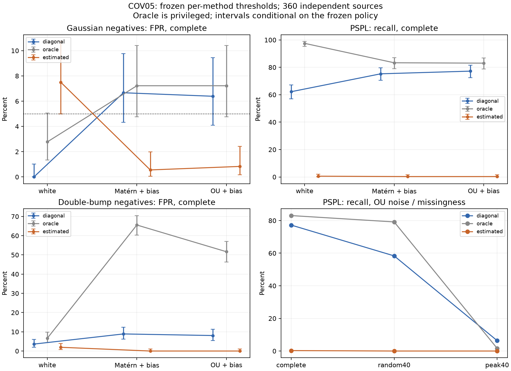

# AstroML — надёжность распознавания микролинзирования

Исследовательский проект для **«Шага в будущее», секция «Системы обработки информации», ИУ5**. Регистрация не подтверждена. Изучаем PSPL-подобные фотометрические сигналы: как пропуски и неверная модель шума меняют ложные тревоги и пропущенные события.

**02.11.2026: baseline синтетическое исследование завершено.** Получены два новых проверенных опыта и отрицательный результат covariance-прототипа. Подготовлен черновик рукописи. Это не оценка реального телескопного обзора и не подтверждение самостоятельной готовности участника к защите.

- **[Рукопись с формулами, результатами и источниками](defense/manuscript.md)**
- **[Итоговый handoff: что доказано, как продолжить](reports/research_handoff.md)**
- [Статус](research/STATUS.md), [очередь](research/task_queue.json), [датированный отчёт](reports/session_2026-11-02.md)
- [Секция, сроки и правила](defense/section_and_rules.md), [личный вклад и помощь ИИ](research/contributions.md)

## Новая недельная кампания

02.11 владелец разрешил продолжение на03–09ноября: **[план недели](research/WEEK_PLAN_2026-11-03.md)**, [очередь с зависимостями](research/task_queue.json). Цель — исправление optimizer, scale-only ablation, новые независимые COV06/stress данные и обновление рукописи. Старые результаты ниже остаются неизменными; новый основной outcome ещё не измерен. Последовательный режим в этом чате,21 окно каждые8часов,120min target; фактическое подтверждение включения — [STATUS](research/STATUS.md). Лимиты аккаунта не видны, выполнение всех окон не гарантируется.

Новая неделя03.11: [development pilot](reports/cov06_development.md) на24sources/219.16s завершён; [independent numerical verification](reports/cov06_numerical_validation.md) проверила2304fits/57304improvement points. Это проверка вычислений, не новые AUC/FPR и не main evaluation. Main/stress protocols и [12-source runner smoke](reports/cov06_pilot.md) завершены. [Calibration240sources/frozen policy](reports/covariance06/calibration_freeze.md) проверена; [Новая evaluation](reports/covariance06/evaluation_manifest.json):176/360sources сохранены/восстановлены (numerical proof пока для прежних68); полный outcome ещё не получен. [Продолжение из GitHub](research/cov06/RESUME.md).

## Два результата

**R2: место пропуска важно.** При SNR15 на360 новых matched source pairs:

| Покрытие | Точек | AUC | FPR при одном frozen threshold | Recall |
|---|---:|---:|---:|---:|
| Полное | 96 | .9949 | 4.17% | 97.78% |
| Случайно удалены40% | 58 | .9680 | 13.89% | 92.78% |
| Удалены40% около пика | 58 | .5757 | 1.94% | 10.00% |

Разность AUC peak−random=**−.3923 [−.4178;−.3687]**,95% paired source-bootstrap CI. Низкий FPR при потере пика сопровождается пропуском90% positives. Это результат конкретного метода/генератора, не невозможность любого распознавания. [Отчёт](reports/reconstruction_02.md), [данные/hashes](reports/reconstruction02/artifacts.json).


**COV05: practical covariance-прототип не помог.** Новый опыт:240 calibration/360 evaluation sources,3 seeds; основной scenario — OU noise + заниженная sigma, complete, Gaussian negatives.

| Метод | FP/360; FPR | TP/360; recall | Coverage |
|---|---|---|---:|
| Reported diagonal | 23;6.39% | 278;77.22% | 100% |
| True covariance, **oracle** | 26;7.22% | 299;83.06% | 100% |
| Estimated covariance | 3;.83% | 1;.28% | 100% |

ΔFPR=−5.56п.п. [−9.72;−2.78], Δrecall=−76.94п.п. [−83.89;−70.56];95% bootstrap учитывает calibration и evaluation. **Совместный критерий пользы не выполнен.** Найдены converged local failures: у estimated correct Gaussian fits159/360 NLL хуже допустимой oracle-точки. Это ограничение finite3-start реализации; вывода о бесполезности всех GP нет.

[Полный отчёт/все scenarios](reports/experiment_05.md), [метрики/CI/все draws](reports/covariance05/evaluation_summary.json), [raw shards/SHA256](reports/covariance05/artifacts.json), [проверка87480 fits](reports/checks/cov05_evaluation_verifier.json).



## Что делает код

PSPL:

$$u(t)=\sqrt{u_0^2+((t-t_0)/t_E)^2},\quad A(u)=\frac{u^2+2}{u\sqrt{u^2+4}},\quad F(t)=F_sA(u(t))+F_b.$$

Сравниваются constant/PSPL/Gaussian means. В COV05 профилируются неотрицательные линейные коэффициенты и используется полный Gaussian likelihood с logdet. Практический вход — только `Observations(t, flux, sigma)`; generator truth хранится отдельно. Oracle получает true covariance только в явно выделенной ветви. BIC-score не вероятность класса; PSPL не доказывает чёрную дыру.

Классы, маски и noise variants одной latent source зависимы. Разбиение сделано до views; bootstrap идёт по sources. Policies и scientific fingerprints отправлены в GitHub до evaluation. Данные, все fits/starts/failures и проверяемые отрицательные результаты сохранены. [Информационный аудит](research/covariance_information_audit.md), [математика](research/covariance_math.md), [freeze audit](reports/checks/cov05_freeze_audit.json).

## Проверить с нуля

Python3.12, Linux/macOS:

```bash
git clone https://github.com/Mobzya/astroML.git
cd astroML
python3.12 -m venv .venv
source .venv/bin/activate
python -m pip install -r requirements-lock.txt
python -m pip install -e . --no-deps
python -m pytest -q
python -m ruff check src scripts tests
```

39 unit tests, включая независимую физическую сверку с MulensModel и новые COV06 numerical safeguards; CI проверяет код и numerical smoke. Научные verifier отдельно пересчитывают сохранённые результаты:6480 R2 и87480 COV05 evaluation fit rows. Ошибка full-NLL пересчёта COV05 не более6.37×10⁻¹²; это проверка вычислений, не global optimization или survey validity.

```bash
python scripts/restore_covariance05.py --phase evaluation --output artifacts/cov05-verify
OPENBLAS_NUM_THREADS=1 OMP_NUM_THREADS=1 python scripts/verify_covariance05.py artifacts/cov05-verify --policy reports/covariance05/frozen_policy.json --summary reports/covariance05/evaluation_summary.json
```

**[Подробное восстановление, версии, повтор и resume](reports/covariance05/REPRODUCE.md).** ZIP shards лежат в Git; Releases asset upload вернул401. Full360-source restore с проверкой90 data files прошёл. Не нужны оставшийся `/workspace`, платные ресурсы или загрузка астрономического обзора. Старые evaluation закрыты для настройки новых методов.

Для короткой учебной иллюстрации, не benchmark: `python scripts/smoke.py --output artifacts/my-smoke`, затем `python scripts/verify_smoke.py artifacts/my-smoke`.

## Литература и границы

Прочитаны конкретные физические/likelihood/GP/ML разделы; [матрица с реальным охватом](research/literature_matrix.csv), [физика](research/reading_notes/L01_L02_physics.md), [GP](research/reading_notes/L03_L04_likelihood.md), [MicroLIA/Microlensify](research/prior_art_comparison.md). Чужие модели не переобучались; превосходство над SOTA и глобальная алгоритмическая новизна не заявлены.

Один nominal SNR, toy priors/negatives,3 seeds, finite optimizer и heuristic BIC. Correlation/scale interventions не разделены полной ablation. Реальные survey performance, prevalence, parameter accuracy, все виды линзирования, RF/CNN и CV не проверены. Внешний pilot или новый optimizer требуют нового протокола и независимых данных.

[Исторические этапы2–4](archive/handoff-2026-11-01/) остаются **REPORTED_ONLY**, старый Stage5 — **UNVERIFIED**: прежние исходники/raw не переданы. Новые R2/COV05 не подменяют старые результаты. [Аудит восстановления](reports/recovery_audit.md).

## Следующий шаг участника

Прочитать рукопись, самостоятельно восстановить и проверить COV05 указанной командой, записать собственное объяснение FPR/recall/coverage и разобрать один false positive. Код и текст нельзя автоматически приписывать участнику. [Задания и журнал](research/contributions.md).

До01.12.2026 требуется оформить тему/секцию; видеовизитка — до10.01.2027 по правилам, проверенным01.11. [Детали](defense/section_and_rules.md). Самостоятельное участие без руководителя предусмотрено; регистрация и правила ИИ отдельно требуют проверки перед подачей.

Интерфейс, изображения звёздного поля и CV — возможное продолжение после личного освоения результатов. Baseline цикл закончен handoff; новая недельная кампания разрешена отдельно. Текущее подтверждённое состояние своей автоматизации — в [STATUS](research/STATUS.md). [План дальнейших этапов](research/research_plan.md).

Лицензия кода пока не назначена. Публичность не означает произвольное разрешение повторного использования; у сторонних источников собственные условия. Секреты, персональные документы и чужие полные тексты не публикуются.


