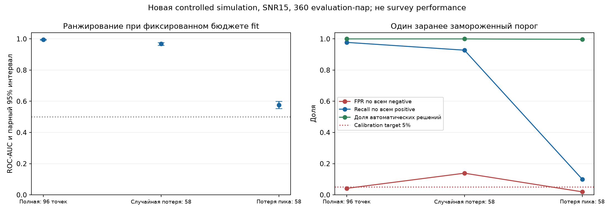
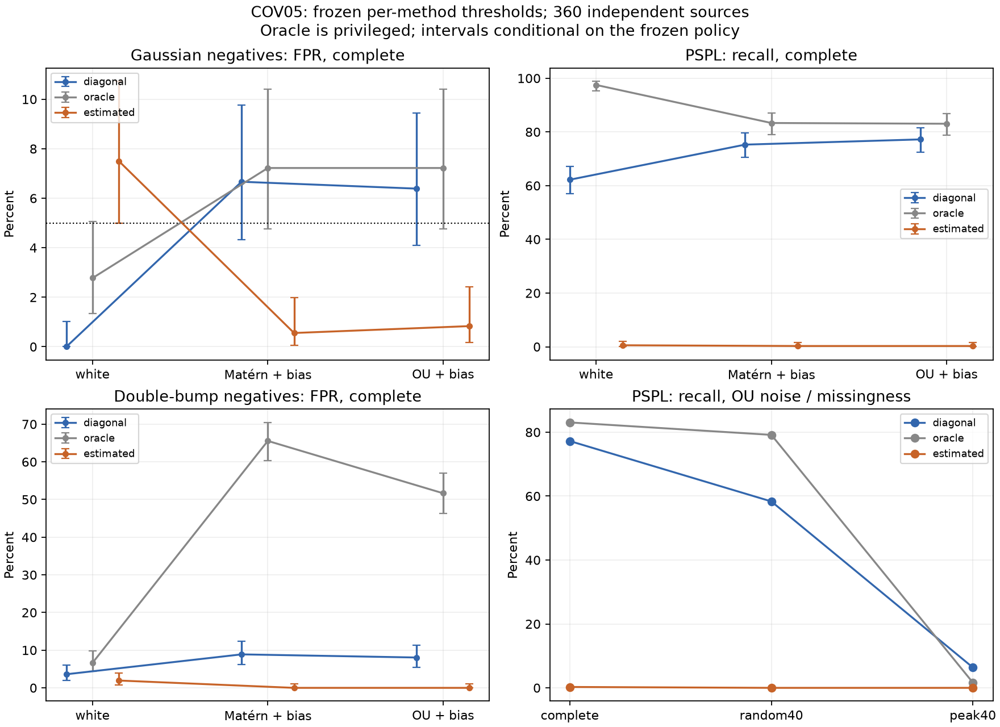
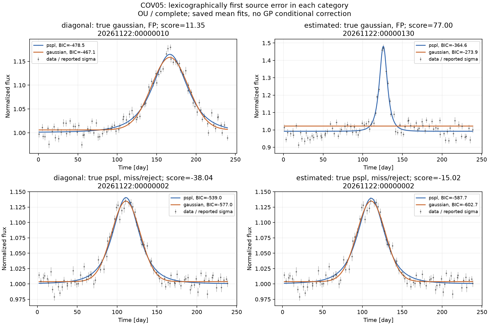

# Устойчивость распознавания PSPL-сигналов при пропусках наблюдений и ошибках модели шума

**AstroML, исследовательский черновик, 02.11.2026.** Предлагаемая секция «Шага в будущее» — «Системы обработки информации», ИУ5. ФИО, школа и класс заполняются участником. Текст, код и вычисления подготовлены с помощью Codex; личное понимание и самостоятельный вклад участника пока не проверены. Это материал для изучения и доработки, а не готовое заявление об авторстве.

## Аннотация

Исследуется распознавание синтетических сигналов точечной гравитационной линзы по фотометрическим временным рядам. Проверены два заранее зафиксированных вопроса: влияние положения пропуска при одинаковом числе наблюдений и польза оценки ковариации шума по самим наблюдениям. В каждом опыте использованы240 калибровочных и360 новых оценочных источников, три seed; зависимые варианты одного источника не разделяются между выборками.

В опыте R2 при номинальном SNR15 удаление40% точек около истинного пика дало AUC0.5757 против0.9680 при случайном удалении того же числа точек. Парная разность −0.3923,95% bootstrap-интервал[−0.4178;−0.3687]. В опыте COV05 оценка ковариации снизила FPR в основном новом шумовом сценарии с6.39% до0.83%, но recall упал с77.22% до0.28%; заранее заданный совместный критерий пользы не выполнен. Дополнительная oracle-диагностика выявила локальные провалы оптимизации даже при флаге convergence. Показаны ограничения конкретного вычислительного метода; универсальная невозможность распознавания и бесполезность любых GP-моделей не утверждаются. Исходные наблюдения, fits, конфигурации, интервалы и независимые проверки опубликованы.

## 1. Проблема и цель

Гравитационное микролинзирование изменяет наблюдаемый блеск фоновой звезды. Однако похожая форма может возникнуть из-за собственной переменности или ошибок измерений. Недостаточно найти гладкий всплеск: необходимо оценить ложные тревоги, пропущенные события и устойчивость к условиям наблюдения.

Цель работы — проверить границы надёжности конкретного физико-статистического распознавателя в контролируемой синтетической популяции. Исследовательский вклад состоит в согласованных альтернативах, сравнении масок при равном числе точек, разделении по исходным источникам и воспроизводимом анализе отрицательного результата. Новизна PSPL, BIC, RF или Gaussian processes не заявляется.

Гипотеза R2: положение пропуска существенно для выбранного score; основная величина — AUC_peak40−AUC_random40. Гипотеза COV05: observation-only covariance может снизить FPR относительно diagonal baseline без потери recall более5 процентных пунктов и при coverage не ниже80%. Эти вопросы и критерии были сохранены в GitHub до соответствующих данных.

## 2. Физическая и статистическая основа

Для точечного источника и точечной линзы при равномерном прямолинейном движении [1]:

$$u(t)=\sqrt{u_0^2+((t-t_0)/t_E)^2},\qquad A(u)=\frac{u^2+2}{u\sqrt{u^2+4}},$$
$$F(t)=F_sA(u(t))+F_b.$$

Здесь t0 — время максимума, u0 — минимальное расстояние в единицах радиуса Эйнштейна, tE — характерное время, Fs — поток источника, Fb — постоянный добавочный поток. Blending осложняет восстановление параметров [2]. Даже известное tE не задаёт массу линзы без геометрии и движения; PSPL-подобное событие не доказывает чёрную дыру.

Для остатка r=y−m и ковариации C=LLᵀ полная Gaussian negative log likelihood [3,4]:

$$\mathcal L=\frac12\|L^{-1}r\|^2+\sum_i\log L_{ii}+\frac n2\log(2\pi).$$

При оценке C нельзя опускать logdet: увеличение дисперсии уменьшает quadratic residual, а normalization противодействует этому. В covariance-методе GP latent values интегрированы; гиперпараметры оптимизированы, не маргинализированы полностью.

Используется BIC=2ℒ+klog n и score=min(BIC_constant,BIC_Gaussian)−BIC_PSPL. Положительная величина предпочитает PSPL среди заданных моделей; score не является вероятностью класса. Исходная асимптотическая постановка BIC [7] не даёт прямой гарантии для наших finite, correlated, nonlinear fits с границами параметров. Здесь это заранее выбранная эвристика, оцениваемая отдельным опытом.

## 3. Связь с литературой

MicroLIA [5] использует признаки временного ряда и ML-классификацию; исходная статья описывает47 признаков, тогда как текущая библиотека имеет другое представление. Microlensify [6] использует physics-informed transformer VAE, синтетические positives и реальные TESS negatives,940-точечное представление и отбор хорошо покрытых событий. Их данные, разметка и splits отличаются от нашего paired experiment. Переобучение этих систем и сравнение SOTA здесь не выполнялись.

Точный охват прочитанных разделов, версии и ограничения извлечения текста записаны в [литературной матрице](../research/literature_matrix.csv) и [аудите ближайших подходов](../research/prior_art_comparison.md). Чтение выбранных работ не доказывает глобальную новизну исследования. Наш вопрос уже: как изменяются ошибки одного зафиксированного метода при контролируемом изменении наблюдений и noise model.

## 4. Данные и единица независимости

Оба опыта имеют разные namespaces и новые latent sources; старые исторические evaluation не использовались для выбора метода. В каждом namespace три seed, на seed80 calibration и120 evaluation sources. Source объединяет общие физические параметры, времена, ошибки, noise draw, классы и маски. Все его варианты зависимы и остаются вместе.

| Параметр генератора | Распределение |
|---|---|
| u0 | Uniform[0.15;1] |
| t0 | Uniform[60;180] дней |
| tE | Log-uniform[8;35] дней |
| Fs | Uniform[0.3;0.9], Fb=1−Fs |
| Времена | 96 неперекрывающихся интервалов за240 дней, по одной случайной точке в каждом |
| White sigma | H/15 × Uniform[0.8;1.2] на точку |

H=Fs(A(u0)−1) — аналитический избыток в пике. Gaussian alternative имеет тот же baseline, H, центр и FWHM избытка. Если Ah=(A(u0)+1)/2, то uh²=2(Ah/√(Ah²−1)−1) и FWHM=2tE√(uh²−u0²); Gaussian width=FWHM/(2√(2log2)). Наблюдаемые максимумы после шума и конечного sampling совпадать не обязаны.

Маски complete, random40 и peak40 оставляют96,58 и58 точек. Peak40 удаляет38 ближайших к истинному t0 измерений. Это вмешательство генератора, а не практический алгоритм определения скрытого пика. Inference получает только t,flux,sigma_report. Обоим классам внутри source добавляется общий шум; это уменьшает несогласованность сравнений, но не удваивает число независимых объектов.

COV05 дополнительно содержит double bump: сумму двух одинаковых Gaussian с согласованными baseline, peak excess, outer FWHM и envelope center. Максимумы находятся иначе. Метка negative относится к этой synthetic PSPL-vs-alternative задаче: реальная двухпиковая кривая может иметь физическую binary-lens природу, которую наш опыт не классифицирует.

## 5. Методы, freeze и метрики

В R2 подгоняются constant, PSPL и Gaussian при известных диагональных ошибках,9 nonlinear starts, ограниченный бюджет. Threshold выбирается только по complete Gaussian calibration negatives с empirical target FPR5% и затем переносится без изменения на все маски.

COV05 использует общий для трёх режимов engine: nonnegative linear coefficients профилируются whitened NNLS; nonlinear mean/noise параметры оптимизируются bounded L-BFGS-B с3 starts, maxiter120/maxfun2000 на start. Сравниваются fixed reported diagonal C, fixed true C с явной oracle-пометкой и estimated C:

$$C_{ij}=(s\sigma_i)^2\delta_{ij}+a^2(1+\sqrt3d_{ij}/\ell)\exp(-\sqrt3d_{ij}/\ell).$$

Bounds: s∈[.5;3], a/median(sigma_report)∈[10⁻⁴;4], ell∈[1;120] дней. Полные mean bounds и starts — в [протоколе](../research/experiment_05_protocol.md). Число mean parameters1/5/4, в estimated режиме ещё3 noise parameters. Oracle — диагностический контроль с недоступным в практике знанием, а не гарантированный верхний предел качества классификации.

Calibration COV05 содержит white и Matérn3/2, только полные PSPL/Gaussian кривые. Evaluation дополнительно содержит OU kernel, обе маски и double bump. Correlated noise amplitude=.8median(sigma_true), length12 дней; reported sigma=.65sigma_true. Nominal SNR15 задан по white компоненте, а не по полному добавленному шуму. Estimated одновременно исправляет scale и correlation; scale-only ablation не выполнена, поэтому чистый вклад kernel не изолирован.

Для каждого метода один global threshold выбирается по480 зависимым negative views из240 calibration sources. Это empirical operating point, не Neyman–Pearson гарантия. Policy и scientific fingerprint опубликованы до evaluation; [freeze R2](https://github.com/Mobzya/astroML/commit/a0eb03bc31f664fecffc14171266fe33208a9163), [freeze COV05](https://github.com/Mobzya/astroML/commit/4a94d440186a34c1a8de4cdc0b76d0f4cd715871). [Аудит неизменности](../reports/checks/cov05_freeze_audit.json) прошёл.

Operational prediction требует convergence всех competing means; иначе reject. Recall_all и FPR_all имеют полные знаменатели. Coverage — доля доступных валидных решений, не доля положительных ответов. Raw AUC использует finite scores, включая flagged nonconverged solutions; это отдельная диагностика. Brier не считается без probability model.

95% интервалы FPR/recall одного scenario — conditional Clopper–Pearson по360 independent sources. R2 использует500 paired source bootstrap replicates, стратифицированно по seed. COV05 primary bootstrap отдельно resample calibration и evaluation clusters, пересчитывая threshold внутри каждой реплики; все зависимые views идут вместе. Secondary comparisons описательные, без simultaneous error control.

## 6. Результаты R2

| Покрытие | AUC [95% source-bootstrap CI] | FP/360; FPR | TP/360; recall |
|---|---|---|---|
| complete | .9949 [.9921;.9974] | 15;4.17% | 352;97.78% |
| random40 | .9680 [.9583;.9766] | 50;13.89% | 334;92.78% |
| peak40 | .5757 [.5520;.5992] | 7;1.94% | 36;10.00% |

Primary ΔAUC_peak−random=−.3923,95%CI[−.4178;−.3687]. Для этого метода и генератора положение пропуска существенно при одинаковом числе оставшихся точек. Это не теорема о невозможности любого другого classifier.

Frozen threshold−4.20783885 дал12/240 FP на calibration. При random40 evaluation FPR вырос до13.89% (conditional95%CI[10.49;17.90]%). Низкий FPR1.94% при peak40 сопровождается recall10%, поэтому его нельзя считать хорошим обнаружением. Coverage complete/random100%, peak99.72%.

[Таблицы, все seed и CI](../reports/reconstruction02/evaluation_summary.json), [полный отчёт](../reports/reconstruction_02.md). Independent verifier пересчитал6480 fit rows; max numerical difference5.68×10⁻¹³. Evaluation заняла430.85s при4 workers.

## 7. Результаты COV05 и отрицательные находки

Primary scenario — OU+sigma bias, complete, Gaussian negatives:

| Метод | FP/360; FPR | TP/360; recall | Coverage | AUC |
|---|---|---|---|---|
| diagonal | 23;6.39% | 278;77.22% | 100% | .9426 |
| oracle | 26;7.22% | 299;83.06% | 100% | .9641 |
| estimated | 3;.83% | 1;.28% | 100% | .6663 |

Estimated−diagonal: ΔFPR=−5.56п.п.,95% joint-bootstrap CI[−9.72;−2.78]; Δrecall=−76.94п.п.,CI[−83.89;−70.56]. Требование нижней границы Δrecall≥−5п.п. нарушено. **Совместная гипотеза практической пользы не поддержана.** Малый FPR получен при почти полном отсутствии обнаружений; он не компенсирует пропуски. Все решения primary формально converged: результат не объясняется удалением неудачных источников из знаменателя.

Для заранее заданной дополнительной double-bump alternative в OU/complete FPR diagonal=29/360=8.06%, oracle=186/360=51.67%. Это описательный результат: правильная covariance не гарантирует контроль неизвестного mean family. Estimated имеет0 FP, но прежний recall.28%; ноль ошибок на360 negatives также не доказывает нулевой риск.

После freeze добавлена **exploratory oracle-диагностика**, не меняющая predictions. Для correct mean истинные параметры задают допустимую точку. Если сохранённая NLL хуже NLL этой точки, пропущено допустимое улучшение, хотя расстояние до global optimum неизвестно. Для estimated в OU/complete таких случаев55/360 PSPL и159/360 Gaussian; у diagonal/oracle —0. Truth используется только контролем; практическому методу она не передаётся. Это показывает, что convergence/coverage не удостоверяют global optimum.

В [конкретном calibration-примере](../reports/covariance05/calibration_failure_example.json) estimated Gaussian fit выбрал amplitude0 и center302дня вне наблюдаемого окна0–238дней; все3 starts сообщили convergence. Его NLL−47.39 хуже допустимой точки−111.36. Это не доказательство единственной причины всех пропусков: влияние calibration threshold, local optimization, signal absorption и misspecification по отдельности не оценено. Вывод относится к finite3-start pipeline, а не ко всем covariance-aware методам.

Иллюстрации выбирают первый по source ID ошибочный случай каждой категории, не лучший или самый драматичный. Показаны saved PSPL/Gaussian mean fits и reported sigma; score дополнительно учитывает constant model, не показанную линией. GP conditional correction к mean не добавляется. Полный [реестр случаев](../reports/covariance05/illustrative_cases.json).

## 8. Проверяемость, стоимость и ограничения

COV05:2483.64s накопленного времени evaluation-вызовов,4 processes/1BLASthread, CPU quota2 cores. Суммы внутренних elapsed timers: diagonal1460s, estimated6204s; это не изолированный randomized CPU benchmark. Все87480 fit rows, full NLL/BIC, linear KKT/bounds, matching/masks, white oracle control, метрики и500 bootstrap draws проверены независимо. Max NLL difference6.37×10⁻¹². [Verifier](../reports/checks/cov05_evaluation_verifier.json), [среда](../reports/covariance05/execution_environment.json).

Первая calibration COV05 остановилась после48 сохранённых sources из-за inf NNLS coefficient при finite norm. Ошибка и несохранённый следующий batch раскрыты; до evaluation введён finite guard, calibration целиком повторена. Изменений метода после открытия evaluation не было. [Неудача](../reports/checks/cov05_failed_calibration.json).

Полный output восстановлен из Git с проверкой90 data files. GitHub Releases asset upload вернул401; компактные неизменяемые ZIP shards сохранены обычным разрешённым push. [Индекс/hashes](../reports/covariance05/artifacts.json), [инструкция с нуля](../reports/covariance05/REPRODUCE.md). Нет платных ресурсов, внешних писем, массового survey download, обучения по evaluation или открытия reserved final test.

Ограничения: один nominal SNR, узкий prior источников, toy negatives/noise, finite optimizer budget, эвристический BIC,500 bootstrap replicates и только3 seed. R2/COV используют разные engines и namespaces: разность между опытами не изолирует GP effect. Реальные telescope data, распространённость событий, parameter-estimation coverage, binary lenses, внешние ML baselines, CV и neural networks здесь не проверены. Balanced FDR не переносится на редкие survey events. Исторические этапы2–4 остаются REPORTED_ONLY, старый Stage5 UNVERIFIED; новый опыт их не восстанавливает.

## 9. Выводы

1. В проверенной популяции потеря пика снижает различимость выбранным score сильнее случайных пропусков при том же числе точек.
2. Calibration FPR и высокая AUC не гарантируют перенос рабочего порога; FPR, recall и coverage нужны совместно.
3. Конкретный observation-only covariance pipeline не выполнил критерий пользы; converged local failures ограничивают смысл сравнения. Корректное вычисление density не равно корректной оптимизации всех competing models.
4. Известная covariance не защищает от всех новых отрицательных форм. Нужны отдельные новые протоколы для улучшения optimizer, scale-only ablation или реальных данных; текущие evaluation нельзя использовать для такой настройки.

Ограниченное исследование завершено независимо от отрицательного исхода. Окончательный конкурсный текст, личное воспроизведение и устная защита требуют работы участника.

## Источники и приложения

1. Paczyński B. (1986), *Gravitational microlensing by the galactic halo*. DOI[10.1086/164140](https://doi.org/10.1086/164140); [прочитанный охват](../research/reading_notes/L01_L02_physics.md).
2. Woźniak P., Paczyński B. (1997), *Microlensing of Blended Stellar Images*. DOI[10.1086/304607](https://doi.org/10.1086/304607), arXiv:astro-ph/9702194v1; [заметки](../research/reading_notes/L01_L02_physics.md).
3. Hogg D., Bovy J., Lang D. (2010), *Data analysis recipes: Fitting a model to data*, arXiv:1008.4686v1; [выбранные разделы](../research/reading_notes/L03_L04_likelihood.md).
4. Rasmussen C., Williams C. (2006), *Gaussian Processes for Machine Learning*, chapters2/4/5; [точные pages/охват](../research/reading_notes/L03_L04_likelihood.md).
5. Godines D. et al. (2019), *A Machine Learning Classifier for Microlensing in Wide-Field Surveys*. DOI[10.1016/j.ascom.2019.100298](https://doi.org/10.1016/j.ascom.2019.100298), arXiv:2004.14347v1; [аудит](../research/prior_art_comparison.md).
6. Kalantari A. et al. (2026), Microlensify, arXiv:2608.19419v1; [версия/охват/code](../research/prior_art_comparison.md). Заявленные авторами результаты не воспроизведены здесь.
7. Schwarz G. (1978), *Estimating the Dimension of a Model*. DOI[10.1214/aos/1176344136](https://doi.org/10.1214/aos/1176344136); [прочитанный охват и пределы BIC](../research/reading_notes/L18_BIC.md).

Дополнительно: [математика COV](../research/covariance_math.md), [информационный аудит](../research/covariance_information_audit.md), [вклад и ИИ](../research/contributions.md), [правила/секция на01.11](section_and_rules.md), [итоговый handoff](../reports/research_handoff.md). PDF и чужие полные тексты не перепубликуются; этот Markdown — черновик, не финальная конкурсная вёрстка.
