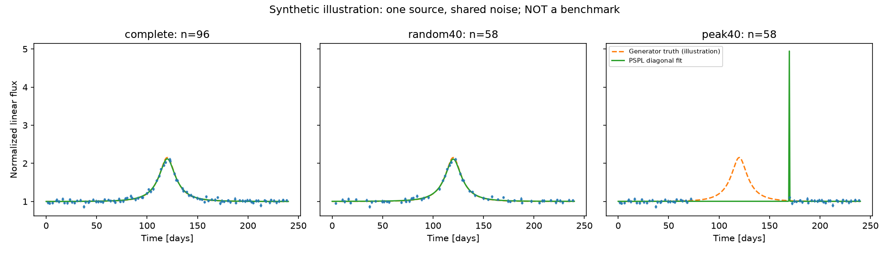

# Начальная проверка реконструкции — 01.11.2026

## Происхождение

Исполнявшийся код: `dccbb14211d4b3ad7027ea610bf6f2b6249da5a6`; рабочее дерево при генерации чистое. Это новая реализация, а не исходники прежних этапов. Python 3.12.14; NumPy 2.5.4; SciPy 1.18.1; Matplotlib 3.11.2; MulensModel 3.12.0. Полное окружение — requirements-lock.txt.

## Выполненные проверки

| Проверка | Фактический результат |
|---|---|
| pytest | 10 passed, включая независимый MulensModel; пропущенных нет |
| Ruff | All checks passed |
| PSPL против MulensModel | 9 сочетаний u0/tE × 101 точка; max absolute error 3.552713678800501e-15 |
| Smoke | 1 независимый источник, три вида наблюдений; 96/58/58 точек |
| Независимый пересчёт | 9 fits, χ²/BIC; max absolute difference 1.2789769243681803e-13 |
| Повтор seed | CSV наблюдений, маски, truth, fits и PNG побайтово совпали |
| Отрицательный контроль | Изменённый fits.json отклонён по контрольной сумме |
| Архив | 12 файлов проверены по SHA256; ZIP CRC без ошибок |

Логи — [checks](checks/). Данные и параметры — [examples/bootstrap-20261101](examples/bootstrap-20261101/). Manifest хранит SHA кода, версии, seed и hashes каждого артефакта. Wall time основного smoke: 0.702 s в этой среде; это не оценка времени на компьютере участника.

## Точные команды

```bash
python -m pytest -q
python -m ruff check src scripts tests
python scripts/smoke.py --output artifacts/bootstrap-20261101
python scripts/verify_smoke.py artifacts/bootstrap-20261101
python scripts/smoke.py --output artifacts/bootstrap-20261101-repeat
```

В сессии команды выполнялись интерпретатором `.venv/bin/python`. Проверку опубликованного примера можно повторить без fit: `python scripts/verify_smoke.py reports/examples/bootstrap-20261101`.

## Иллюстрация и её пределы



Две маски удаляют одинаковое число измерений. Истинный t0 использован только при построении синтетической peak-маски; подгонка получает только Observations. Оранжевая линия — истина генератора, а не доступная детектору информация.

В peak40 получен узкий fitted всплеск внутри пробела, где нет наблюдений. Это показывает риск интерпретации экстраполяции в данном примере. Частота такого эффекта, качество классификации, неопределённость параметров и ROC-AUC здесь **не измерены**. Нельзя делать популяционный вывод по одному источнику или считать эти три вида независимыми событиями.

Модель ковариации пока проверена только как численный likelihood primitive, практическая estimated-C ещё не реализована. Исторические Stage2–4 по-прежнему REPORTED_ONLY; Stage5 не завершён.

## Следующий минимальный тест

Проверить согласование amplitude/FWHM PSPL и Gaussian в новом генераторе и source-level разбиение; перед оценкой различимости зафиксировать отдельный протокол R2. Участнику самостоятельно объяснить, почему fitted кривая в пробеле не доказывает наличие всплеска.
