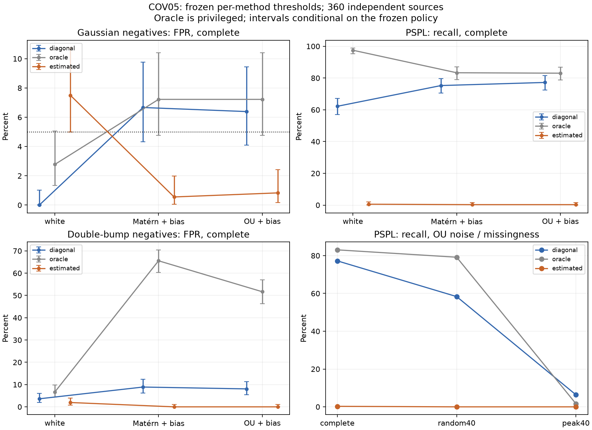

# COV05: covariance-aware fitting — 02.11.2026

Новый заранее заданный опыт:240 calibration и360 independent evaluation sources,3 seeds. Calibration white/Matérn, evaluation дополнительно OU и double bump; SNR15,96/58 точек. Это toy simulation, не телескопная проверка.

## Primary outcome

Scenario `ou_biased/complete/gaussian`, estimated−diagonal. ΔFPR=-0.055556,95%CI[-0.09722222222222222, -0.027777777777777776]; Δrecall=-0.769444,95%CI[-0.8388888888888889, -0.7055555555555556].

Заранее заданный совместный критерий поддержан: **False**. Требования: upper CI ΔFPR<0, lower CI Δrecall≥−.05, estimated coverage≥.80. 500 seed-stratified paired source bootstrap draws отдельно resample calibration и evaluation; порог пересчитан внутри каждого bootstrap. Views одного source сохраняются вместе.

| Method | FP/360 | FPR | TP/360 | Recall | Coverage |
|---|---:|---:|---:|---:|---:|
| diagonal | 23 | 6.39% | 278 | 77.22% | 100.00% |
| oracle | 26 | 7.22% | 299 | 83.06% | 100.00% |
| estimated | 3 | 0.83% | 1 | 0.28% | 100.00% |

Oracle получает true covariance только в отдельной ветви. Practical estimated получает только t/flux/reported sigma; truth не передаётся. Метод/пороги после evaluation не изменены.

## Все заранее заданные scenarios

В каждой строке360 independent positives и360 negatives. PSPL повторяется при смене negative family; строки нельзя складывать как независимые. CI ниже — conditional Clopper–Pearson95%; secondary contrasts описательные, без simultaneous control.

| Noise / mask / negative | Method | FP | FPR [95%CI] | TP | Recall [95%CI] | Coverage | AUC |
|---|---|---:|---|---:|---|---:|---:|
| white/complete/gaussian | diagonal | 0 | 0.00% [0.00%;1.02%] | 224 | 62.22% [56.99%;67.25%] | 100.00% | 0.9983 |
| white/complete/gaussian | oracle | 10 | 2.78% [1.34%;5.05%] | 351 | 97.50% [95.31%;98.85%] | 100.00% | 0.9983 |
| white/complete/gaussian | estimated | 27 | 7.50% [5.00%;10.72%] | 2 | 0.56% [0.07%;1.99%] | 100.00% | 0.8617 |
| white/complete/double_bump | diagonal | 13 | 3.61% [1.94%;6.10%] | 224 | 62.22% [56.99%;67.25%] | 100.00% | 0.9731 |
| white/complete/double_bump | oracle | 24 | 6.67% [4.32%;9.76%] | 351 | 97.50% [95.31%;98.85%] | 100.00% | 0.9731 |
| white/complete/double_bump | estimated | 7 | 1.94% [0.79%;3.97%] | 2 | 0.56% [0.07%;1.99%] | 100.00% | 0.7399 |
| white/random40/gaussian | diagonal | 0 | 0.00% [0.00%;1.02%] | 118 | 32.78% [27.95%;37.89%] | 100.00% | 0.9714 |
| white/random40/gaussian | oracle | 35 | 9.72% [6.87%;13.26%] | 327 | 90.83% [87.37%;93.61%] | 100.00% | 0.9714 |
| white/random40/gaussian | estimated | 1 | 0.28% [0.01%;1.54%] | 1 | 0.28% [0.01%;1.54%] | 100.00% | 0.8666 |
| white/random40/double_bump | diagonal | 29 | 8.06% [5.46%;11.36%] | 118 | 32.78% [27.95%;37.89%] | 100.00% | 0.8836 |
| white/random40/double_bump | oracle | 67 | 18.61% [14.72%;23.02%] | 327 | 90.83% [87.37%;93.61%] | 100.00% | 0.8836 |
| white/random40/double_bump | estimated | 3 | 0.83% [0.17%;2.42%] | 1 | 0.28% [0.01%;1.54%] | 100.00% | 0.6750 |
| white/peak40/gaussian | diagonal | 0 | 0.00% [0.00%;1.02%] | 1 | 0.28% [0.01%;1.54%] | 100.00% | 0.5699 |
| white/peak40/gaussian | oracle | 4 | 1.11% [0.30%;2.82%] | 12 | 3.33% [1.73%;5.75%] | 100.00% | 0.5699 |
| white/peak40/gaussian | estimated | 0 | 0.00% [0.00%;1.02%] | 0 | 0.00% [0.00%;1.02%] | 100.00% | 0.5622 |
| white/peak40/double_bump | diagonal | 0 | 0.00% [0.00%;1.02%] | 1 | 0.28% [0.01%;1.54%] | 100.00% | 0.5885 |
| white/peak40/double_bump | oracle | 4 | 1.11% [0.30%;2.82%] | 12 | 3.33% [1.73%;5.75%] | 100.00% | 0.5885 |
| white/peak40/double_bump | estimated | 0 | 0.00% [0.00%;1.02%] | 0 | 0.00% [0.00%;1.02%] | 100.00% | 0.5769 |
| matern_biased/complete/gaussian | diagonal | 24 | 6.67% [4.32%;9.76%] | 271 | 75.28% [70.49%;79.65%] | 100.00% | 0.9327 |
| matern_biased/complete/gaussian | oracle | 26 | 7.22% [4.77%;10.40%] | 300 | 83.33% [79.07%;87.03%] | 100.00% | 0.9632 |
| matern_biased/complete/gaussian | estimated | 2 | 0.56% [0.07%;1.99%] | 1 | 0.28% [0.01%;1.54%] | 100.00% | 0.6709 |
| matern_biased/complete/double_bump | diagonal | 32 | 8.89% [6.16%;12.32%] | 271 | 75.28% [70.49%;79.65%] | 100.00% | 0.9401 |
| matern_biased/complete/double_bump | oracle | 236 | 65.56% [60.40%;70.46%] | 300 | 83.33% [79.07%;87.03%] | 100.00% | 0.4267 |
| matern_biased/complete/double_bump | estimated | 0 | 0.00% [0.00%;1.02%] | 1 | 0.28% [0.01%;1.54%] | 100.00% | 0.7539 |
| matern_biased/random40/gaussian | diagonal | 28 | 7.78% [5.23%;11.04%] | 204 | 56.67% [51.37%;61.85%] | 100.00% | 0.8773 |
| matern_biased/random40/gaussian | oracle | 46 | 12.78% [9.51%;16.67%] | 282 | 78.33% [73.71%;82.48%] | 100.00% | 0.9084 |
| matern_biased/random40/gaussian | estimated | 0 | 0.00% [0.00%;1.02%] | 0 | 0.00% [0.00%;1.02%] | 100.00% | 0.6592 |
| matern_biased/random40/double_bump | diagonal | 54 | 15.00% [11.47%;19.11%] | 204 | 56.67% [51.37%;61.85%] | 100.00% | 0.8360 |
| matern_biased/random40/double_bump | oracle | 174 | 48.33% [43.06%;53.63%] | 282 | 78.33% [73.71%;82.48%] | 100.00% | 0.5744 |
| matern_biased/random40/double_bump | estimated | 1 | 0.28% [0.01%;1.54%] | 0 | 0.00% [0.00%;1.02%] | 100.00% | 0.7312 |
| matern_biased/peak40/gaussian | diagonal | 11 | 3.06% [1.53%;5.40%] | 11 | 3.06% [1.53%;5.40%] | 100.00% | 0.4735 |
| matern_biased/peak40/gaussian | oracle | 6 | 1.67% [0.61%;3.59%] | 7 | 1.94% [0.79%;3.97%] | 100.00% | 0.5240 |
| matern_biased/peak40/gaussian | estimated | 0 | 0.00% [0.00%;1.02%] | 0 | 0.00% [0.00%;1.02%] | 100.00% | 0.5246 |
| matern_biased/peak40/double_bump | diagonal | 12 | 3.33% [1.73%;5.75%] | 11 | 3.06% [1.53%;5.40%] | 100.00% | 0.4747 |
| matern_biased/peak40/double_bump | oracle | 7 | 1.94% [0.79%;3.97%] | 7 | 1.94% [0.79%;3.97%] | 100.00% | 0.5318 |
| matern_biased/peak40/double_bump | estimated | 0 | 0.00% [0.00%;1.02%] | 0 | 0.00% [0.00%;1.02%] | 100.00% | 0.5423 |
| ou_biased/complete/gaussian | diagonal | 23 | 6.39% [4.09%;9.43%] | 278 | 77.22% [72.54%;81.45%] | 100.00% | 0.9426 |
| ou_biased/complete/gaussian | oracle | 26 | 7.22% [4.77%;10.40%] | 299 | 83.06% [78.77%;86.78%] | 100.00% | 0.9641 |
| ou_biased/complete/gaussian | estimated | 3 | 0.83% [0.17%;2.42%] | 1 | 0.28% [0.01%;1.54%] | 100.00% | 0.6663 |
| ou_biased/complete/double_bump | diagonal | 29 | 8.06% [5.46%;11.36%] | 278 | 77.22% [72.54%;81.45%] | 100.00% | 0.9466 |
| ou_biased/complete/double_bump | oracle | 186 | 51.67% [46.37%;56.94%] | 299 | 83.06% [78.77%;86.78%] | 100.00% | 0.5886 |
| ou_biased/complete/double_bump | estimated | 0 | 0.00% [0.00%;1.02%] | 1 | 0.28% [0.01%;1.54%] | 100.00% | 0.7384 |
| ou_biased/random40/gaussian | diagonal | 27 | 7.50% [5.00%;10.72%] | 210 | 58.33% [53.05%;63.48%] | 100.00% | 0.8869 |
| ou_biased/random40/gaussian | oracle | 47 | 13.06% [9.75%;16.98%] | 285 | 79.17% [74.60%;83.25%] | 100.00% | 0.9122 |
| ou_biased/random40/gaussian | estimated | 0 | 0.00% [0.00%;1.02%] | 0 | 0.00% [0.00%;1.02%] | 100.00% | 0.6721 |
| ou_biased/random40/double_bump | diagonal | 52 | 14.44% [10.98%;18.51%] | 210 | 58.33% [53.05%;63.48%] | 100.00% | 0.8389 |
| ou_biased/random40/double_bump | oracle | 146 | 40.56% [35.44%;45.83%] | 285 | 79.17% [74.60%;83.25%] | 100.00% | 0.6557 |
| ou_biased/random40/double_bump | estimated | 0 | 0.00% [0.00%;1.02%] | 0 | 0.00% [0.00%;1.02%] | 100.00% | 0.7245 |
| ou_biased/peak40/gaussian | diagonal | 20 | 5.56% [3.43%;8.45%] | 23 | 6.39% [4.09%;9.43%] | 100.00% | 0.4936 |
| ou_biased/peak40/gaussian | oracle | 5 | 1.39% [0.45%;3.21%] | 6 | 1.67% [0.61%;3.59%] | 100.00% | 0.5279 |
| ou_biased/peak40/gaussian | estimated | 0 | 0.00% [0.00%;1.02%] | 0 | 0.00% [0.00%;1.02%] | 100.00% | 0.5232 |
| ou_biased/peak40/double_bump | diagonal | 19 | 5.28% [3.21%;8.12%] | 23 | 6.39% [4.09%;9.43%] | 100.00% | 0.5003 |
| ou_biased/peak40/double_bump | oracle | 5 | 1.39% [0.45%;3.21%] | 6 | 1.67% [0.61%;3.59%] | 100.00% | 0.5316 |
| ou_biased/peak40/double_bump | estimated | 0 | 0.00% [0.00%;1.02%] | 0 | 0.00% [0.00%;1.02%] | 100.00% | 0.5419 |

## Численные отказы, бюджет и воспроизводимость

Evaluation elapsed 2483.64s,4 CPU workers,1 BLAS thread; maximum per-worker RSS 57248KiB.

| Method | Sets | Invalid sets | Nonconverged fits | Numerical objective failures | Σ elapsed across workers (s) |
|---|---:|---:|---:|---:|---:|
| diagonal | 9720 | 0 | 0 | 405 | 1460.0 |
| oracle | 9720 | 0 | 0 | 468 | 1424.1 |
| estimated | 9720 | 0 | 0 | 5502 | 6203.7 |

Диагностика всех starts/nfev/covariance conditions и попаданий noise-параметров на bounds: [diagnostics](covariance05/diagnostics.json). Невалидные решения отвергаются; recall/FPR имеют полные знаменатели. Raw AUC использует best finite score и остаётся диагностикой, а не performance принятого subset.

Первая calibration остановилась на48 источниках из-за inf Gaussian NNLS coefficient при finite residual norm. [Неудачная попытка и hashes](checks/cov05_failed_calibration.json) сохранены. До evaluation введён finite-coefficient guard и regression test; calibration целиком выполнена заново. Bounds/starts/пороговый протокол не подбирались по evaluation.

Thresholds: `{"diagonal": 6.916426455022731, "oracle": -3.593344890888772, "estimated": 73.69523337163282}`. Каждый выбран на480 dependent negative views из240 sources; это empirical5%, не distribution-free гарантия. Freeze commit и точные команды записаны в [freeze](covariance05/calibration_freeze.md).

[Protocol](../research/experiment_05_protocol.md), [config](../configs/experiment_05.json), [summary/all bootstrap draws/per-seed](covariance05/evaluation_summary.json), [raw artifacts/SHA256](covariance05/artifacts.json), [independent verifier](checks/cov05_evaluation_verifier.json).

## Границы вывода

Один SNR, finite optimizer budget, три toy negative/noise families и только3 seeds. GP гиперпараметры оптимизированы, не маргинализированы; BIC heuristic при bounds и неидентифицируемости. Возможны локальные минимумы и signal absorption; причинный вклад каждого механизма отдельно не измерен. Реальные переменные звёзды/артефакты и survey prevalence не представлены; balanced FDR не оценивает telescope contamination. Никакая PSPL-классификация не доказывает чёрную дыру. Отрицательный outcome не означает невозможности любого covariance-aware метода; положительный не переносится за популяцию.

R2 и COV05 имеют разные namespaces и fitting engines/budgets: R2 использует9 nonlinear starts, COV05 —3 starts с профилированием linear coefficients. Поэтому сравнение разных опытов не изолирует пользу GP; primary comparison проводится внутри COV05 на одинаковых sources. Суммы внутренних elapsed timers не являются CPU-time или изолированным randomized runtime benchmark. [Среда](covariance05/execution_environment.json).

## Exploratory oracle-контроль локальных минимумов

Контроль добавлен после freeze без изменения детектора. True parameters задают допустимую точку correct mean; estimated использует допустимый Matérn candidate даже для OU data. Если selected NLL больше candidate на>1e−5, пропущено допустимое улучшение. Это нижняя оценка числа локальных провалов, не practical truth-based алгоритм и не новый primary endpoint.

Primary OU/complete; для каждого correct mean360 independent sources:

| Method | True mean | Missed feasible improvement | Max NLL gap |
|---|---|---:|---:|
| diagonal | pspl | 0/360 | -0.755 |
| diagonal | gaussian | 0/360 | -0.393 |
| oracle | pspl | 0/360 | -0.222 |
| oracle | gaussian | 0/360 | -0.074 |
| estimated | pspl | 55/360 | 43.889 |
| estimated | gaussian | 159/360 | 49.098 |

[Полная диагностика](covariance05/evaluation_local_minima.json), [calibration](covariance05/calibration_local_minima.json), [математическое обоснование](../research/covariance_math.md). Convergence/coverage не доказывают global optimum. Если optimization не справляется, outcome относится к конкретному finite-budget pipeline; польза ideal covariance estimation остаётся отдельным вопросом.

Negative здесь означает заданную synthetic alternative к PSPL. Double bump — сумма Gaussian; реальные двухпиковые события могут требовать binary-lens и других физических моделей. Классификация всех видов микролинзирования не проверена.

Correlated noise cases одновременно добавляют GP и меняют reported sigma. Estimated mode исправляет scale и correlation вместе; scale-only ablation не выполнена. Эффект нельзя приписывать только kernel. SNR15 задан по white diagonal sigma, а не по полному шуму после добавления GP.
