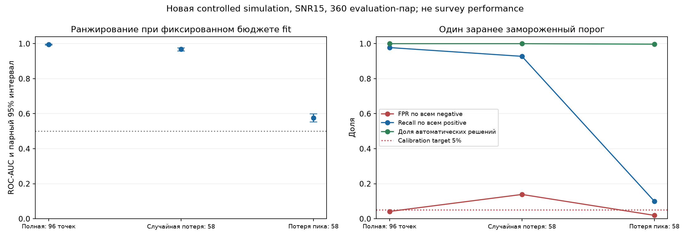

# R2: новый controlled missingness эксперимент — 02.11.2026

Протокол зафиксирован до данных;12 development pairs использованы только для проверки кода/стоимости. Основная calibration:240 независимых пар; evaluation:360 новых пар, три seeds. В каждой паре PSPL/Gaussian согласованы по nuisance и шуму. SNR15, white heteroskedastic noise.

Это новый ограниченный опыт; исторические результаты остаются REPORTED_ONLY. Искусственное удаление true peak — вмешательство генератора, недоступное детектору.

## Результаты из сохранённых решений

| Условие | Точек | AUC [парный95%CI] | FP / negative; FPR [95%CI] | TP / positive; recall | Coverage |
|---|---:|---|---|---|---|
| complete | 96 | 0.9949 [0.9921;0.9974] | 15/360; 4.17% [2.35;6.78] | 352/360; 97.78% | 100.00% |
| random40 | 58 | 0.9680 [0.9583;0.9766] | 50/360; 13.89% [10.49;17.90] | 334/360; 92.78% | 100.00% |
| peak40 | 58 | 0.5757 [0.5520;0.5992] | 7/360; 1.94% [0.79;3.97] | 36/360; 10.00% | 99.72% |

Primary AUC_peak40−AUC_random40 = **-0.3923**, парный95%CI **[-0.4178;-0.3687]**,500 bootstrap replicates по latent pair, стратификация по seed.

Отрицательная разность поддерживает заранее заданный эффект в этой controlled population.

Порог **-4.20783885** выбран на complete calibration negatives (12/240 FP), затем применён без изменения. Целевые5% на calibration не являются гарантией на evaluation или при ином покрытии.

## Интерпретация и ограничения

AUC использует budget-limited fit score, включая best finite iterate при отсутствии converged start. Operational rule отвергает такие fits: отказы включены в знаменатель recall_all, а FPR_all считается по всем negative. Малый FPR при низком recall не означает полезного обнаружения. BIC-score не probability.

Одинаковое число оставшихся точек позволяет отделить место пропуска от их количества в рамках этого генератора. Эффект не доказывает фундаментальную невозможность composite detection: остаются модельные priors, конечный optimizer budget и заданные negative shapes. Отдельные параметры линзы здесь не оценены по accuracy/coverage.

Binomial CI относятся к независимым источникам одного условия и условны на замороженной policy; неопределённость calibration не маргинализирована. Все три masked views в bootstrap остаются вместе; они не утроили число независимых источников. Другие SNR/noise families, реальные телескопы, CNN и covariance-aware fitting не проверялись.

## Воспроизводимость

Evaluation runtime: 430.85s на4 workers; maximum per-worker RSS 51340KiB, не суммарная память. Independent verifier пересчитал 6480 fit rows; max absolute numeric difference 5.68e-13.

Протокол: [reconstruction_02_protocol.md](../research/reconstruction_02_protocol.md). Frozen policy commit: a0eb03b, до генерации evaluation. Полные scores/point metrics/CI по условиям и seed: [summary](reconstruction02/evaluation_summary.json). Raw archives и SHA256: [артефакты](reconstruction02/artifacts.json). Логи проверки: [verifier](checks/reconstruction02_evaluation_verifier.json).

График и таблица автоматически построены из JSON без нового fit или изменения threshold. Для повторения: распаковать raw archive; выполнить verify_reconstruction02.py с --summary и --policy, затем plot_reconstruction02.py/write_reconstruction02_report.py.

Следующий вопрос: насколько шумовая covariance меняет надёжность и можно ли оценить её по наблюдениям без поглощения физического сигнала. Нужен отдельный protocol/namespace; это не доказанная польза GP.
